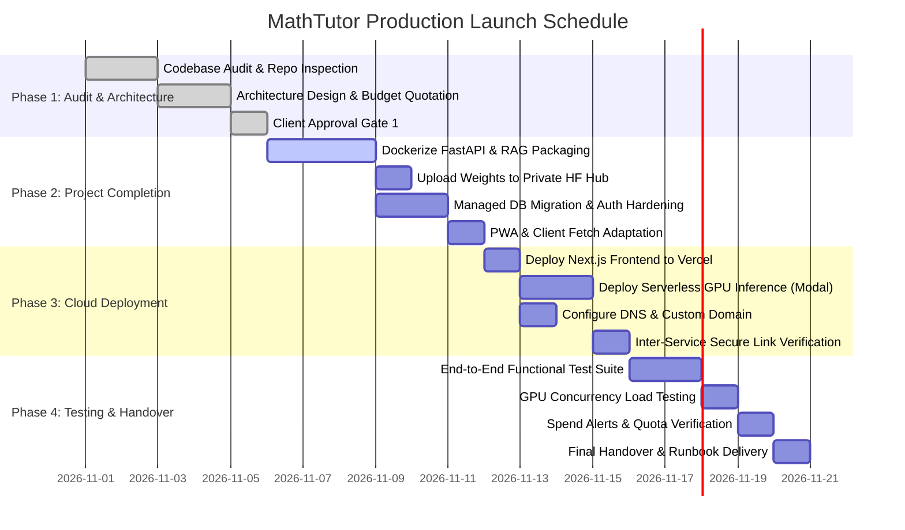

# 4-Phase Deployment Roadmap & Execution Timeline

This roadmap outlines the exact execution timeline to transition **MathTutor** from local laptop development into a publicly deployed cloud educational platform within the one-time **₹20,000 INR** budget.

---

## 1. Roadmap Overview & Timeline

---

## 2. Phase-by-Phase Deliverables & Milestones

### PHASE 1 — Audit and Planning (COMPLETED)
- [x] Full codebase audit of `MathTutor` (Next.js 16) and `MathsLLM` (FastAPI + Qwen3-4B).
- [x] Identification of working features (8 chapters, 320+ examples, 5 visualizers, auth, PWA).
- [x] Decoupling plan for local Windows paths (`start_all.ps1`, `models/`).
- [x] Production cloud architecture designed (Scale-to-zero serverless GPU + Vercel).
- [x] Itemized one-time quotation prepared (strictly ₹20,000 INR).

### PHASE 2 — Project Completion & Packaging (Est: 4–5 Days)
- [ ] Create private Hugging Face Model repository and upload `MathsQwen3-4B-LoRA` (33 MB safetensors).
- [ ] Create `deploy_modal.py` / Dockerfile for cloud GPU container.
- [ ] Provision Neon Serverless PostgreSQL instance and run automated table migrations (`scripts/migrate.js`).
- [ ] Provision Upstash Redis REST database and configure distributed IP rate limiting.
- [ ] Seed initial production administrator account via `npm run seed:admin`.

### PHASE 3 — Deployment & Network Linking (Est: 2–3 Days)
- [ ] Deploy Next.js repository to Vercel with root directory set to `MathTutor`.
- [ ] Deploy AI inference server to Modal (`modal deploy deploy_modal.py`).
- [ ] Configure environment variables in Vercel (`BACKEND_URL`, `DATABASE_URL`, `UPSTASH_*`).
- [ ] Register custom domain (e.g. `mathtutor.in`), assign DNS A/CNAME records, and verify SSL.
- [ ] Verify cross-service communication with test chat request from live frontend.

### PHASE 4 — Testing, Hardening & Handover (Est: 2–3 Days)
- [ ] **Functional Testing:** Verify all 8 chapters, 320+ worked examples, 575+ exercises, and 5 visualizers load without errors.
- [ ] **Chat Accuracy:** Test standard Class 10 questions (Cartesian product, one-to-one functions, quadratic formulas) to verify model accuracy and textbook citations.
- [ ] **Security Checks:** Verify Argon2id password hashing, HttpOnly session cookie flags, and that raw error stack traces are hidden from users.
- [ ] **Load Testing:** Execute `load_test.py` across 5, 10, 25, and 50 concurrent requests.
- [ ] **Spend Caps:** Configure hard spending limit ($15/month) in Modal/RunPod to prevent surprise bills.
- [ ] **Handover:** Deliver all operational runbooks, credentials reference, and administrator guides to project owner.

---

## 3. Approval Gates

> [!IMPORTANT]
> In accordance with project instructions, **no paid cloud services, domain registrations, or destructive database commands will be executed without explicit owner approval at each phase boundary.**

