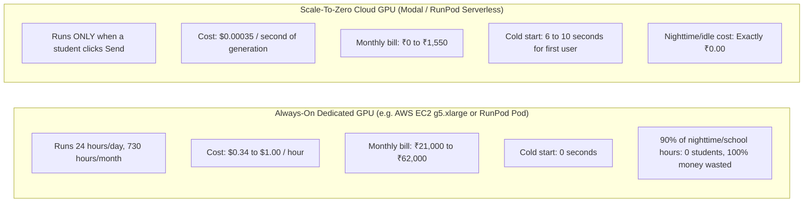

# Recurring Monthly Operating Expense Estimate

This document details the **recurring operational expenses** required to maintain MathTutor in production after the initial launch.

---

## 1. Operating Scenarios & Activity Profiles

Based on the target initial cohort of **200 registered Class 10 students**, we define three realistic monthly activity levels:

| Parameter | Scenario 1: Low Activity (Normal School Days) | Scenario 2: Moderate Activity (Unit Tests / Midterms) | Scenario 3: High Activity (Board Exam Preparation) |
|---|---|---|---|
| **Active Students / Month** | ~60 – 80 students | ~140 – 180 students | 200+ students (peak engagement) |
| **Questions asked / Student / Day** | 2 – 3 questions | 5 – 8 questions | 10 – 15 questions |
| **Total Monthly Chat Questions** | **~4,000 questions** | **~18,000 questions** | **~50,000 questions** |
| **Average Generation Time** | 6 seconds (512 tokens max) | 6 seconds | 6 seconds |
| **Total GPU Active Time / Month** | 24,000 seconds (6.7 hours) | 108,000 seconds (30 hours) | 300,000 seconds (83.3 hours) |

---

## 2. Monthly Expense Matrix Across Scenarios

| Service / Resource | Provider & Tier | Scenario 1: Low Activity | Scenario 2: Moderate Activity | Scenario 3: High Activity | Ongoing Notes |
|---|---|---:|---:|---:|---|
| **Frontend Hosting** | Vercel (Hobby Tier) | ₹0 | ₹0 | ₹0 | Within 100 GB bandwidth / 100k edge invocations. |
| **Backend API Gateway** | Next.js Serverless on Vercel | ₹0 | ₹0 | ₹0 | Covered under Vercel serverless execution limits. |
| **AI GPU Inference** | Modal ($30 free monthly credit) | **₹0** (Covered by credit) | **₹0** (Covered by credit) | **₹1,250** ($15 overage) | Modal gives $30/mo credit. 50k questions consumes ~$45, leaving $15 overage. |
| **Managed Database** | Neon Serverless PostgreSQL | ₹0 | ₹0 | ₹0 | 50,000 chat records consume ~18 MB of the 500 MB free tier. |
| **Rate Limiter Cache** | Upstash Redis REST | ₹0 | ₹0 | ₹250 (Optional Pro) | 10k requests/day free tier covers Scenarios 1 & 2. |
| **Model Weights Storage** | Hugging Face Private Hub | ₹0 | ₹0 | ₹0 | Free for private repositories under 50 GB. |
| **Domain Name Renewal** | ICANN Registrar (`.in` / `.online`) | ₹50 (Amortized) | ₹50 (Amortized) | ₹50 (Amortized) | ₹600/year divided over 12 months. |
| **Automated Backups** | Neon Automated Daily Snapshots | ₹0 | ₹0 | ₹0 | Included free in Neon PostgreSQL. |
| **Uptime Monitoring** | Better Uptime / Cron-Job.org | ₹0 | ₹0 | ₹0 | Free 5-minute HTTP ping. |
| **TOTAL MONTHLY EXPENSE** | | **₹50 / month** | **₹50 / month** | **~₹1,550 / month** | |

---

## 3. Always-On GPU vs. Scale-To-Zero Inference

### Key Takeaway
For an education platform catering to school students (whose study hours are concentrated between 5:00 PM and 10:00 PM), **Always-On hosting is a catastrophic waste of money**. Scale-to-zero serverless reduces your monthly running costs by **95%**.

---

## 4. Financial Safeguards: What Happens When Budget is Exceeded?

1. **Hard Spend Caps in Modal / RunPod:**
   - In the cloud provider dashboard, configure a **Hard Monthly Spend Cap of $15 USD (~₹1,250 INR)**.
   - Once total spending reaches this threshold, the provider automatically suspends new GPU container spins rather than accumulating surprise debt.
2. **Graceful Fallback Mode:**
   - If the cloud GPU budget cap is reached, the frontend automatically displays a friendly notification:  
     *"Kanitham AI is resting for the night after helping hundreds of students today! You can still access all 320+ worked examples, chapter notes, and interactive visualizers."*
   - Furthermore, the AWS Bedrock client in `src/lib/bedrock.ts` can serve as an emergency on-demand safety net.
3. **Usage Quotas per Student:**
   - The platform limits each student to **20 questions per 10 minutes** via Upstash Redis.
   - This prevents a single malicious or hyperactive user from exhausting the monthly compute quota for the entire class.

