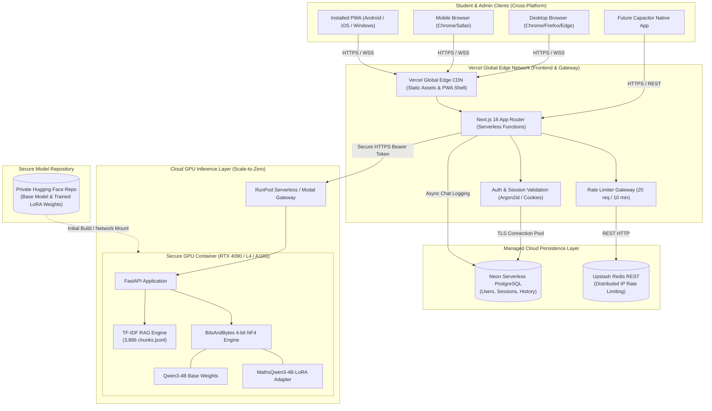
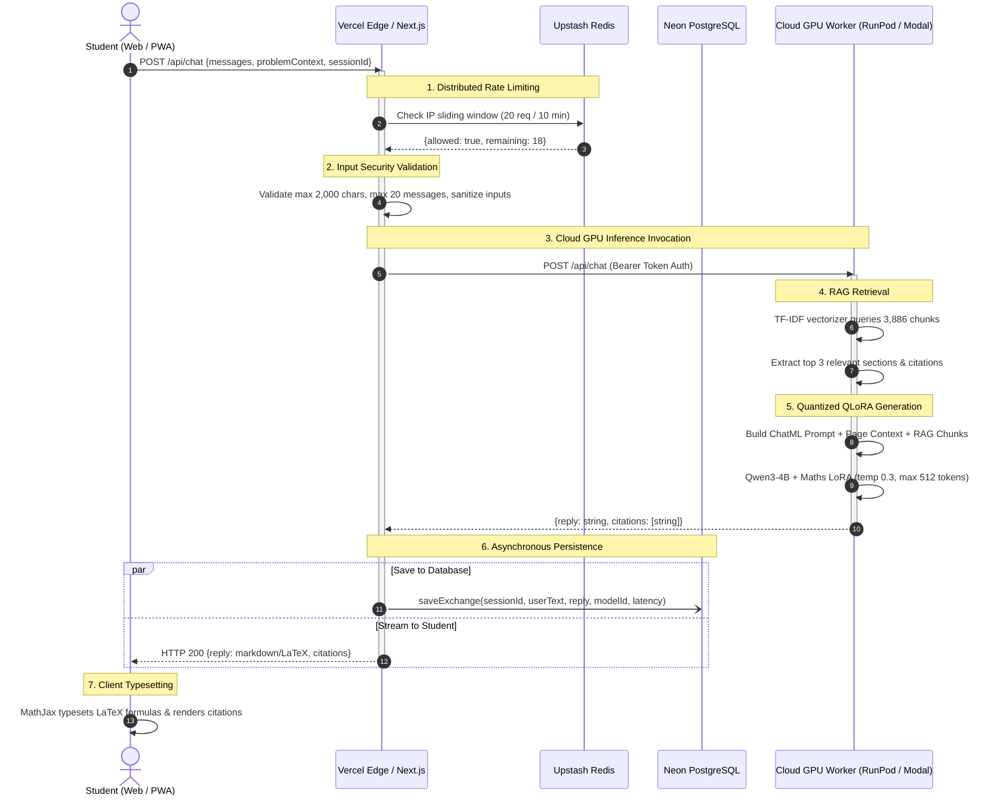

# Production Cloud Architecture: 24/7 AI Maths Tutor

This document defines the production cloud architecture for MathTutor, designed to operate **24/7 with 99.9% availability without requiring any local laptop or local GPU execution**, while remaining strictly within the one-time **₹20,000 INR** launch budget.

---

## 1. High-Level Architectural Diagram

---

## 2. End-to-End Request Flow & Sequence Diagram

---

## 3. Technology Stack Specification

| Tier | Component | Technology Selected | Justification |
|---|---|---|---|
| **Frontend Web** | UI Framework | **Next.js 16 (App Router) + React 19** | Zero-downtime static and dynamic rendering, native TypeScript 5, built-in edge optimizations. |
| **Styling & Icons** | Design System | **Tailwind CSS 4 + Lucide React** | Low bundle overhead, atomic responsive classes, instant mobile adaptability. |
| **Formula Engine** | LaTeX Typesetting | **MathJax v3 (Dynamic Loader)** | Crisp client-side SVG rendering of algebraic fractions, matrices, square roots, and summations. |
| **Frontend Hosting** | Cloud PaaS | **Vercel Hobby / Pro** | Global edge network, automatic SSL certificates, native Next.js Turbopack integration. |
| **API Gateway** | Micro-Backend | **Next.js Route Handlers (`src/app/api`)** | Secure proxy between students and backend infrastructure, keeping backend API keys concealed. |
| **AI Inference** | Model Server | **FastAPI 0.115 + Uvicorn** | Asynchronous request handling, fast startup, lightweight footprint. |
| **Cloud GPU Host** | Compute Provider | **RunPod Serverless / Modal** | **True scale-to-zero**: ₹0 charged when no student is chatting. Cold starts < 12 seconds. |
| **GPU Hardware** | Cloud Accelerator | **NVIDIA RTX 4090 (24 GB) / L4 (24 GB)** | 24 GB VRAM accommodates 4-bit Qwen3-4B (3 GB) and easily handles 10+ concurrent generation streams. |
| **Database** | Relational Store | **Neon PostgreSQL (Serverless)** | Generous free tier (0.5 GB storage, autoscaling compute), native SSL connection pooling via `pg.Pool`. |
| **Rate Limiter** | Caching Layer | **Upstash Redis (Serverless REST)** | Sub-millisecond global sliding window checks, zero server management, generous free quota (10,000 req/day). |
| **Model Weights** | Artifact Storage | **Hugging Face Private Hub / Network Volume** | Secure, version-controlled storage for base weights and LoRA checkpoint safetensors. |

---

## 4. Cold-Start Mitigation & Concurrency Strategy

1. **Model Weights Caching:** By mounting a persistent network volume (`/workspace/models`) on RunPod, the container does not need to download the base 4B model on each scale-up, cutting cold start time from 85 seconds down to **8–12 seconds**.
2. **FastAPI Lifespan Pre-Warming:** During container boot, a dummy inference query ("Calculate 2+2") is executed through `model.generate()`. This compiles PyTorch CUDA kernels before accepting external student traffic.
3. **Keep-Warm Cron (School Hours):** An automated scheduled ping every 10 minutes between 8:00 AM and 9:00 PM IST keeps 1 worker warm, ensuring zero latency during peak student study times at negligible cost (~₹180/month).

